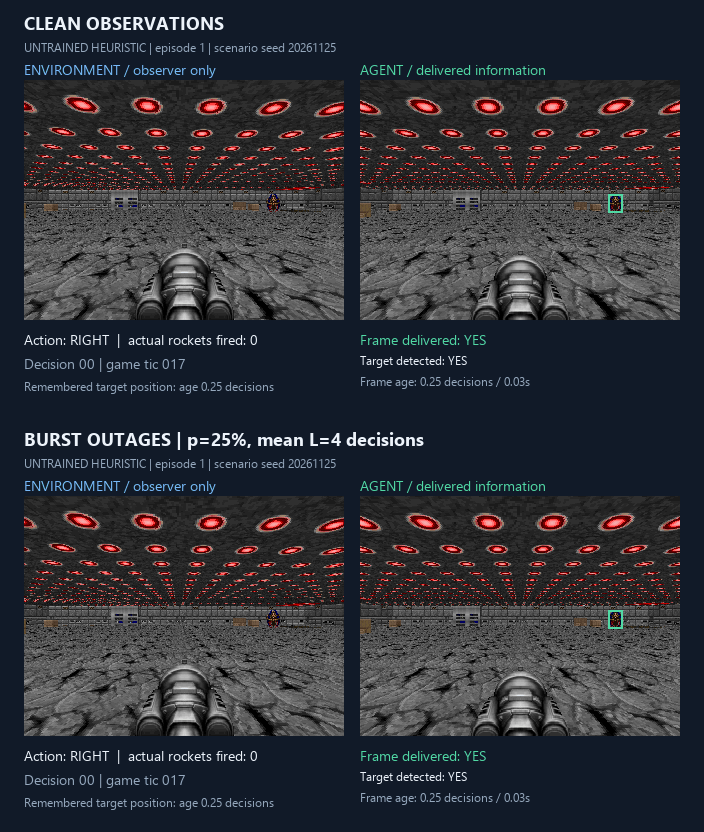

# Does prioritized replay oversample observation outages in ViZDoom?

The experiment is specified in [Research_Proposal_RL2026.md](Research_Proposal_RL2026.md).
Branch **`grouped_replay_implementation`** adds tested replay code, diagnostics,
analysis tools and a **real ViZDoom demo**, while preserving the existing environment.
It does not contain trained Double DQN policies or a completed hypothesis test.

## Watch the real engine

**Untrained heuristic. Top: clean; bottom: burst. In each row, left: the actual
environment; right: information delivered to the agent.**



[Comparison MP4, 8.63 s](demo/output/run1/comparison.mp4) ·
[All clean episodes](demo/output/run1/clean.mp4) ·
[All burst episodes](demo/output/run1/burst.mp4) ·
[Episode-level results](demo/output/run1/episodes.csv) ·
[Run metadata](demo/output/run1/summary.json)

ViZDoom **1.3.3**, bundled `predict_position` scenario and Freedoom assets.
Frames come from the real engine's screen buffer; only explanatory overlays and
the missing-data mask are drawn. No trained checkpoint was available. The heuristic
estimates motion from delivered target labels, turns, and fires one rocket.

| Demo condition | Episodes | Hits | Missed shots | Timeouts | Actual shots |
|---|---:|---:|---:|---:|---:|
| Clean | 6 | 1 | 5 | 0 | 6 |
| Burst p=.25, mean L=4 decisions | 6 | 0 | 6 | 0 | 6 |

Six scenario seeds are shared across conditions; initial screen hashes matched
in every pair. Masks use separate RNG seeds and start available. Realized burst
loss was **53/184 decisions (28.80%)**; the longest gap was **12 decisions (~1.37 s)**.
The first short burst episode had no outage: 25% is stationary probability, not
a per-episode quota. Policy parameters were fixed before these runs.

**This is an untrained-agent demonstration, not evidence that grouped PER works.**
No replay or learning was used in the demo. Neither 1/6 versus 0/6 nor synthetic
sampler examples establish the project's performance hypothesis.

## Implemented in this branch

| Component | Location | Status |
|---|---|---|
| Existing environment / outage processes / random agent | `env/`, `agents.py` | Preserved from main |
| FIFO replay, capacity 50,000 | `replay/outage_replay/buffer.py` | Implemented |
| Uniform, PER, 50/50 mixture, grouped sampling | same | Exact probabilities and global IS normalization |
| Current/next injected outage tags, terminal/timeout rules | same | Tested |
| Ring overwrite, current-max insertion, duplicate priority updates | same | Tested |
| Replay state/RNG checkpoint | same | Replay-only restore, not full training resume |
| TD/count/allocation/weighted-Huber diagnostics | `replay/outage_replay/diagnostics.py` | JSONL with sample-time occupancy and expected sampler share |
| Common frozen-buffer analysis | `replay/outage_replay/frozen.py` | Same transitions/priorities for all four samplers |
| Real CPU optimizer integration example | `replay/examples/learner_integration.py` | Uses supplied networks/optimizer, not a training loop |
| Plotting, synthetic checks and benchmarks | `replay/scripts/`, `replay/results/` | Reproducible evidence included |
| Real engine demo / videos / episode logs | `demo/` | 12 actual episodes recorded |

Details: [repository integration guide](INTEGRATION.md),
[replay README](replay/README.md),
[five improvement cycles](replay/RESEARCH_LOG.md),
[current next steps](replay/NEXT_STEPS.md),
[English Methods text](replay/docs/METHODS.md).

## Fixed replay definitions

Tag `c=1` means an injected outage affects the current observation or a nonterminal
next observation. A scenario timeout ends the finite task; only the current flag
contributes at task end. Target nondetection on a delivered frame is a different state.

```text
u_i          = (abs(TD_i) + 1e-6)^0.6
P_uniform(i) = 1/N
P_PER(i)     = u_i / sum_j u_j
P_mix(i)     = 0.5/N + 0.5*P_PER(i)
P_group(i)   = (|G_c_i|/N) * u_i / sum_{j in G_c_i} u_j
w_raw(i)     = (N * P(i))^(-beta)
w(i)         = w_raw(i) / max_{j in current buffer} w_raw(j)
```

`N` is current occupancy. Groups are selected by current size, then transitions
by priority within the group; there is no fixed group quota per minibatch.
Sampling is with replacement. Duplicate priority updates use `max(abs(TD))`.
First raw priority is 1.0; new insertions use the current maximum before eviction.
Raw priority and exponentiated mass are distinct. Beta follows total collected
decisions, including warm-up. Loss is `mean(weight * unreduced Huber)`; weights
are normalized over the full buffer, not the batch or the selected mixture branch.

## Run replay checks and real demo

From the repository root:

```bash
python -m pip install -e "./replay[analysis,test,learner]"
python -m pytest -c replay/pyproject.toml replay/tests -q
python -m pip install --target demo/vendor -r demo/requirements.txt
python demo/run_demo.py --episodes 6 --output demo/output/new_run
python demo/validate_outputs.py demo/output/new_run
python -m unittest discover -s demo -p test_demo.py -v
```

`demo/vendor` is ignored by Git. Use a new output directory to preserve old runs.
The demo was tested on Windows/Python 3.13 x64, with an ASCII temporary-runtime
workaround for Unicode paths. See [demo/README.md](demo/README.md).
The replay core only needs NumPy; PyTorch is optional for its learner example.

For synthetic diagnostics, run from `replay/`:

```bash
python -m scripts.synthetic_demo --output results/new_synthetic_run
python -m scripts.plot_diagnostics --logs results/new_synthetic_run/logs --frozen-analysis results/new_synthetic_run/frozen_analysis --output results/new_synthetic_run/figures
python -m scripts.benchmark_refresh --output results/new_refresh_benchmark.json
```

## Actual validation and limitations

- **100 replay tests passed**, including formulas, global weights, FIFO,
  duplicate updates, terminal/timeout tags, 200,000 frequency draws per sampler,
  checkpoint RNG continuation, and real CPU optimizer steps.
- **4 demo tests passed** for channel behavior and the observation boundary.
- All **12 real episode logs** were audited: matched initial frames, unchanged
  target memory during outages, shot accounting and `return = hits - .001*tics`.
- Every frame of all three MP4s and the GIF decoded successfully.
- Paired local priority-refresh benchmark: **4.014 → 0.614 ms** median (**6.54x**)
  at N=50,000 / B=64, with bitwise identical priority trees.
- Frozen analysis: **3.619 → 0.656 s** median (**5.51x**) at N=50,000, with
  byte-identical probabilities/weights CSV and summary JSON.

Evidence: [replay validation](replay/results/improvements/validation.json),
[priority benchmark](replay/results/improvements/cycle4_benchmark.json),
[frozen benchmark](replay/results/improvements/frozen_benchmark/comparison.json),
[real demo validation](demo/output/run1/validation.json).
These timings do not measure full training speed.

Replay was checked on Python 3.13.11, NumPy 2.4.2, PyTorch 2.10.0+cpu, pytest 9.0.3;
see `replay/requirements-tested.txt`. The original root dependency pins are
preserved and differ from that environment; their exact combination and GPU
training have not been verified here. No full training, paired policy evaluation
or hierarchical bootstrap has been run.

## Next actions for the team

**Areg — Double DQN and training**

1. Connect this replay interface to the shared learner and implement the common
   training loop, network, exploration, warm-up and target-copy schedule.
2. Use identical observations/rewards/budget across all samplers; apply IS weights
   to unreduced Huber and refresh priorities after optimizer.step from detached TD.
3. Save final checkpoints, config/seed provenance and replay logs. Full resume
   also needs model/target/Adam, clocks, exploration and environment RNG state.

**Leon — environment and paired evaluation**

1. Capture `env.delivered` before step as the current flag; use next
   `info['delivered']` only if the transition is nonterminal.
2. Fix the wrapper's timeout/remaining-time counter discrepancy consistently for
   all methods: default engine start is tic 16, so `t >= 75` is not its timeout
   predicate. Use `game.is_episode_timeout_reached()` and the actual game clock.
3. Do not tag/count a nonexistent next observation after terminal; keep injected
   delivery distinct from detection, and validate history/autoreset/normalization.
4. Record separate scenario/mask seed pairs, keep pilot/train/test seeds disjoint,
   and implement the shared frozen-policy paired evaluation/bootstrap.
5. Verify mixture uses full P_mix regardless of which branch selected a draw.

**Together:** agree on replacement/duplicate conventions, run a common pilot and
the proposal's four samplers × two regimes × three training seeds, then 100
paired held-out seeds per condition. Primary contrast remains grouped minus PER
hit rate after burst training (p=.25,L=4), evaluated on L=8 bursts. Support needs
both improved primary performance and excess outage sampling by PER. A CI crossing
zero leaves improvement unresolved; a similar mixture benefit weakens a grouping-
specific explanation. Replay frequency must be interpreted alongside weighted loss.

The environment files below remain as originally provided; integration issues
and concrete hooks are documented in [INTEGRATION.md](INTEGRATION.md).

## Installation

Python 3.12, no virtual environment:

```
pip install -r requirements.txt
```

## Structure

```
env/
  doom_env.py   predict_position environment (observations from labels + 4-step history)
  outage.py     observation loss models (clean, independent, bursts)
agents.py       agents (only a random agent for now)
test_env.py     tests the environment with a random agent
watch.py        watch an agent play in the ViZDoom window
play.py         play the scenario yourself
```

## Test

```
python test_env.py
```

## Watch an agent / play yourself

```
python watch.py --agent random --condition burst25_L4 --episodes 5
python play.py --episodes 5
```

In `play.py`: left/right arrows (or mouse) to turn, Ctrl (or left click) to fire.

To add an agent, write a class with an `act(obs)` method in `agents.py`
and register it in the `AGENTS` dictionary. It then becomes available in `watch.py --agent`.

## Observation conditions

| name         | description                                    |
|--------------|------------------------------------------------|
| `clean`      | no loss                                        |
| `indep25`    | 25% of frames lost independently               |
| `burst25_L4` | 25% loss in bursts of mean length 4            |
| `burst25_L8` | 25% loss in bursts of mean length 8            |
